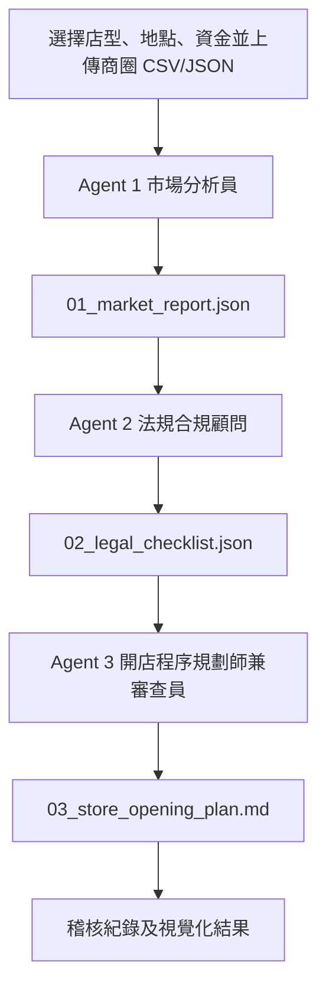

# OpenShop LIFE v3｜台灣開店人生模擬器

> **把開店計畫變成能操作的生活模擬遊戲。** 從選擇店型、輸入商圈資料、完成法規任務，到安排外送策略、試算財務與每日做經營決策。

**版本：v3 PWA Game Studio｜語言：繁體中文｜適用：Windows／桌面瀏覽器；經 HTTPS 部署後可於手機加入主畫面**

[返回專案主頁](../README.md) · [PWA 詳細操作與部署](docs/PWA_操作與部署.md) · [原始 Skill 定義](SKILL.md)

---

## 01｜專案概覽

OpenShop LIFE 是一套以**台灣實體店面創業**為主題的互動式教學系統。使用者建立店鋪後，可以上傳候選商圈 CSV／JSON，交由三階段分析流程產生市場報告、法規檢核與開店規劃，再透過遊戲化的介面體驗營運決策。

| 專案能力 | 數量／狀態 |
| --- | --- |
| 主 Skill | **1 個：`store-opening-advisor`** |
| 角色／Agent | **3 個：市場分析 → 法規合規 → 開店程序與稽核** |
| 產品功能領域 | **6 大能力：法規、員工設備、經營、選址、外送、內外帶** |
| 店鋪類型 | **20 種**（餐飲、零售、服務） |
| 前端 | HTML + CSS + JavaScript，遊戲式 PWA 介面 |
| 後端 | Python FastAPI + 原有資料分析引擎 |
| 另保留 | `app.py`（舊 Streamlit 介面）及 `app_legacy.py` |

> **請注意名詞：** 六大功能有時以「Skill 1–6」說明產品能力，但目前 GitHub 內實際配置的是**一份 `SKILL.md`、三位 Agent 與六大功能模組**；它**不是**六份已可獨立自動觸發的 Skill。網站執行三階段 Python 程式也不等於 AI 模型真的自動載入 Skill。

## 02｜六大功能

| 功能模組 | 操作重點 | 結果呈現 |
| --- | --- | --- |
| **Skill 功能 1｜開店法規** | 依店型檢視登記、食品衛生、消防、建管等應查事項 | 任務式法規檢核、風險提示、官方查核入口 |
| **Skill 功能 2｜員工與設備** | 檢查設備、食材、衛生、人員與營業 SOP | 開店／日常工作清單；個案事項仍須確認 |
| **Skill 功能 3｜老闆經營** | 調整客單價、成本、人力、租金、訂單數 | 預估營收、簡化損益、損益兩平、每日決策 |
| **Skill 功能 4｜智慧商圈選址** | 匯入候選地點資料，修改比較權重 | 商圈 PK 排行、人口／競品／交通／租金比較 |
| **Skill 功能 5｜外送策略** | 調整外送比例、平台抽成、包材成本 | 通路成本與營運情境分析 |
| **Skill 功能 6｜內用／外帶** | 調整內用、外帶、外送比例 | 訂單組合及店面經營策略比較 |

此外另有**建立店鋪**、**教授檔案挑戰**、**報告下載**與**PWA 安裝介面**等跨模組功能。

### 支援店型

目前的店型目錄涵蓋三大產業、20 種台灣常見店型，包括手搖飲店、咖啡廳、早餐店、甜點店、便當店、拉麵店、火鍋店、麵包店、冰品店、服飾店、花店、文具店、書店、寵物用品店、手機配件店、美甲工作室、美髮沙龍、自助洗衣店、健身工作室、花藝教室。各店型有不同的模擬預設參數；**這些預設值不是實際平均營收或成本調查**。

## 03｜三角色 AI Skill 流程



- **Agent 1：市場分析員**：檢查資料品質、比較候選商圈、保留原始來源與假設；輸出 `01_market_report.json`。
- **Agent 2：法規合規顧問**：依店型與地點整理土地使用、商業登記、食品／消防／建管等可能適用要求；輸出 `02_legal_checklist.json`。不宣稱取得官方核准。
- **Agent 3：開店程序規劃師兼審查員**：整合前兩者，安排申辦步驟並稽核預算與高風險項目；輸出 `03_store_opening_plan.md` 及審查資訊。

正式 A／B／C Skill 啟動測試需在**真正支援 Skill 載入的 AI 工具**實測：A 明確開店需求要啟動、B 口語改寫仍要啟動、C 無關問題不應啟動。網站按鈕無法取代此項證據。

## 04｜安裝與啟動（Windows／VS Code）

建議環境：Python 3.11 以上、Windows CMD 或 VS Code 終端機。

### 一鍵方式（推薦）

進入本資料夾 `v3/`，**第一次雙擊 `CHECK_ALL.cmd`** 安裝套件、檢查前端檔案並執行自動測試；之後**雙擊 `START_PWA.cmd`** 啟動新介面。

開啟本機網址：**http://127.0.0.1:8502/**

### 終端機方式

```cmd
cd /d C:\Users\user\Desktop\github_01\ai-skill-project\v3
python -m pip install -r requirements_pwa.txt
python verify_web.py
python -m pytest -q
python -m uvicorn app_pwa:app --host 127.0.0.1 --port 8502
```

> 路徑只是 Windows 操作範例；請依實際 clone 位置調整。關閉伺服器請在終端機按 `Ctrl + C`。

**新版入口是 `app_pwa.py`，不是 `app.py`。** 若需開啟舊版 Streamlit，可執行：

```cmd
python -m streamlit run app.py
```

不要直接雙擊 `web/index.html`：檔案分析與模擬功能需要 FastAPI 後端。

## 05｜教授 Demo：用一份檔案實測

1. 啟動 PWA，進入「**建立我的店鋪**」，設定店型、縣市、商圈與創業預算。
2. 進入「**教授檔案挑戰**」，上傳候選商圈的 CSV 或 JSON。若只是測試操作，可下載 `examples/DEMO_商圈資料_情境假設_非官方.csv`。
3. 執行**三角色完整分析**，確認資料品質、來源檔案 SHA-256、Agent 1／2／3 結果及稽核狀態。
4. 前往「**商圈 PK**」調整權重，比較候選區域排名；再到「**法規通關**」看仍需人工核實的事項。
5. 在「**店面與通路**」與「**老闆財務**」調整參數，觀察不同營運配置結果。
6. 進入「**每日營運**」，進行數次老闆決策並展示現金與損益的變化；最後下載分析報告／模擬資料。

### 支援的資料欄位

主要上傳欄位如下：

```csv
district,population,competitors,footfall,rent,data_source
```

- `district`：候選區域名稱。
- `population`：人口數（需清楚說明統計區域與時間）。
- `competitors`：同業數量（需有一致的定義）。
- `footfall`：交通或人流指標（須註明是實際人流還是車站運量代理值）。
- `rent`：租金（需統一期間與幣別）。
- `data_source`：資料來源／模擬情境標示。

`data_source` 為追溯來源的建議欄位；具體必要欄位及檢核規則以 `scripts/studio_engine.py` 與後端 `/api/catalog` 回傳內容為準。遇到未知格式，應先作欄位對應與單位檢查，**不應補造資料使其通過**。

若只想從 CMD 重現範例分析，可執行：

```cmd
python -m scripts.run_studio --input examples/DEMO_商圈資料_情境假設_非官方.csv --shop 手搖飲店 --city 桃園市
```

**範例 CSV 是合成教學情境，不是政府公開資料，也不應當成實證研究結果。**

## 06｜PWA 手機 App 體驗

新版使用 `web/index.html`、`styles.css`、`app.js`，並包含 `manifest.webmanifest`、`sw.js` 和 `192×192`、`512×512` App 圖示。介面採獨立店鋪設定畫面、遊戲式功能卡片與適合手機的導覽設計。

- **桌面本機測試**：使用 `http://127.0.0.1:8502/`。
- **Android 手機**：需要能以 HTTPS 存取部署的網站，在 Chrome 使用「安裝應用程式／加到主畫面」。
- **iPhone**：用 Safari 開啟 HTTPS 網站，從分享選單選「加入主畫面」。
- **離線限制**：Service Worker 只提供網站殼層快取；沒有 Python 後端連線就不能執行分析或每日決策 API。

GitHub 原始碼本身**不是**已部署的可用 PWA；僅將靜態 `web/` 放在 GitHub Pages，也無法代替 Python FastAPI 後端。部署細節請看 [PWA 操作與部署](docs/PWA_操作與部署.md)。

## 07｜專案主要檔案

```text
v3/
├── readme.md                    ← 本說明（更新後）
├── SKILL.md                     ← 主 Skill 定義與觸發邊界
├── AGENTS.md                    ← AI 協作說明
├── app_pwa.py                  ← v3 FastAPI 後端（正式新版入口）
├── app.py                      ← 舊 Streamlit 介面（保留）
├── app_legacy.py               ← 更早版本介面（保留）
├── START_PWA.cmd               ← 一鍵啟動新版
├── CHECK_ALL.cmd               ← 套件、語法及測試檢查
├── requirements_pwa.txt
├── verify_web.py
├── web/
│   ├── index.html
│   ├── styles.css
│   ├── app.js
│   ├── manifest.webmanifest
│   ├── sw.js
│   └── icons/
│       ├── icon-192.png
│       └── icon-512.png
├── agents/                     ← 3 角色提示與規則
├── scripts/                    ← 解析、模擬、排名、三角色流水線
├── examples/                   ← 非官方教學範例
├── references/                 ← 法規與資料來源說明
├── tests/                      ← 原有及 PWA 測試
├── data/                       ← 原始官方資料需另行取得
├── outputs/                    ← 執行產物
└── docs/                       ← Demo、PWA 及其他文件
```

## 08｜資料真實性、測試與重要限制

- **商圈資料**：來源由上傳者提供。系統會檢查資料格式，但不能單靠 CSV 欄位名稱認定資料已受官方驗證。
- **相對排行**：商圈分數取決於使用者選擇的權重與提供的資料，**不是**實際營業成功率，也不是政府排名。
- **外送及消費偏好**：未取得平台區域訂單與實際消費者調查資料時，僅做假設情境，不能宣稱為某地的真實需求。
- **每日營運**：隨機事件、交易筆數、現金及財務結果是模擬，不是實際商店營運紀錄。
- **法規**：法規核對是輔助，不代表地址分區、消防、建管、食品登錄等已核准；應由主管機關依個案確認。
- **自動觸發**：真正的 AI Skill 載入與 A／B／C 測試須另行取證，不得把網站上的「分析」按鈕當成模型自動觸發。
- **目前驗收**：專案附有 `verify_web.py`、`tests/` 與 `CHECK_ALL.cmd`，可在本機檢查；本 README 不宣稱你的 Windows、Android 或 iOS 端已完成實機驗收。

## 09｜相關文件

- [`SKILL.md`](SKILL.md)：啟動條件、禁止觸發情境、三角色輸入與輸出。
- [`README_PWA.md`](README_PWA.md)：PWA 遊戲版的快速介紹（部分舊版路徑描述請以本頁為準）。
- [`START_HERE_繁體中文.md`](START_HERE_繁體中文.md)：原始修復包的操作歷程（若提及 `v2/`，現在請改用 `v3/`）。
- [`docs/PWA_操作與部署.md`](docs/PWA_操作與部署.md)：安裝、離線、HTTPS 部署與測試說明。

---

**OpenShop LIFE v3**：用遊戲體驗創業的選擇，用資料追溯每一項推論。開店決策不只有「好不好玩」，也必須說清楚**哪些有證據、哪些是模擬、哪些仍需要確認**。
