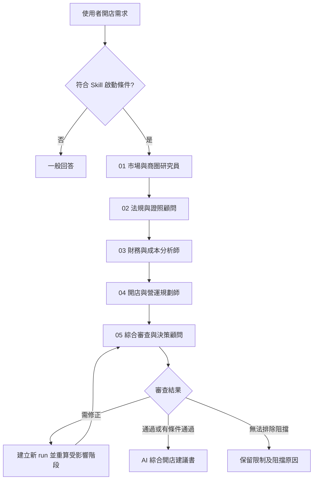

# OpenShop AI V5｜智慧開店可行性評估 Skill

   

**從開店構想到可驗證的創業規劃：以 AI 角色協作結合 Python 資料分析、財務試算與品質審查。**

OpenShop AI V5 是一套面向台灣實體店面、餐飲、零售及服務門市的開店決策輔助 Skill。使用者只需描述店型、地點、預算及營運條件，即可由 AI 依序執行市場研究、法規檢核、財務分析、營運規劃與最終審查，產出可追溯的分析資料及開店建議書。

本版以原始五角色規格為基礎，延續 V4 的分析方法及資料來源，改為獨立的 Skill 與命令列工具，不需要網頁、FastAPI 或 PWA。Python 負責可重現的數值計算；AI 負責需求理解、角色判斷、結果解讀及跨角色交接。

> 本專案為課程實作與決策輔助工具。合成資料不代表政府統計，情境試算不保證獲利，法規清單不代表主管機關核准。

## 1. 專案特色

- 一個主 Skill、五個獨立角色指令模組；可由同一 AI 循序執行，不必平行呼叫五個模型。
- 自然語言需求解析與啟動邊界，避免純行銷文案、翻譯或無關問題啟動開店流程。
- 支援 CSV／JSON、資料清理、來源追溯、四項商圈權重及敏感度分析。
- 支援 20 種既有店型的教學參數，並可傳入實際預算、單價、租金、員工及營業條件。
- 全職／兼職人事成本估算、三種財務情境、損益兩平、資金續航及逐日營運模擬。
- 五階段結構化交接、SHA-256 完整性驗證、跨角色一致性檢查及錯誤修正規則。
- 產出 JSON、CSV、Markdown、PNG 圖表及 AI 綜合開店建議書，無須啟動網頁。

## 2. 系統架構與五角色分工



| 角色 | 輸入與職責 | 主要輸出 |
|---|---|---|
| Agent 01 市場與商圈研究員 | 使用者需求、候選地點、商圈資料；清理、比較、客群假設 | `01_market_report.json`、`agent_notes_01.md` |
| Agent 02 法規與證照顧問 | 市場結果及業態；辨識登記、食品、消防、建管等待確認事項 | `02_legal_checklist.json`、`agent_notes_02.md` |
| Agent 03 財務與成本分析師 | 市場、法規、預算與成本；人事估算、營收、損益、敏感度 | `03_financial_report.json`、`agent_notes_03.md` |
| Agent 04 開店與營運規劃師 | 前三階段結果；設備、人力、通路、營運模擬、開店排程 | `04_business_plan.json`、`04_opening_schedule.md`、`agent_notes_04.md` |
| Agent 05 綜合審查與決策顧問 | 前四階段成果及原始資料；獨立重算、風險與一致性檢查 | `05_audit_report.json`、`06_final_report.md`、`agent_notes_05.md` |

每階段開始前才讀取對應角色指令及必要上游成果，遵循漸進式揭露。AI 解讀 Python 結果並寫入角色紀錄，再交接下一階段。最終由 AI 整合產出 `07_ai_business_advice.md`。Python 不會自動填寫 AI notes，也不會將計算成功冒充 Skill 自動觸發。

## 3. 專案結構

以下為 GitHub V5 的主要原始檔案結構；`outputs/` 與 `data/` 為執行時產生的本機目錄。

```text
v5/
├── .agents/skills/store-opening-advisor/
│   ├── SKILL.md
│   ├── agents/
│   │   ├── 01_market_researcher.md
│   │   ├── 02_legal_advisor.md
│   │   ├── 03_financial_analyst.md
│   │   ├── 04_business_planner.md
│   │   └── 05_reviewer.md
│   ├── scripts/
│   │   ├── engine.py
│   │   ├── run.py
│   │   ├── prepare_data.py
│   │   └── download_official.py
│   ├── references/
│   │   ├── data_sources.md
│   │   └── verified_official_sources.md
│   └── assets/report_template.md
├── sample-data/
│   ├── config_demo.json
│   ├── market_demo.csv
│   └── etl_mapping_demo.json
├── tests/test_engine.py
├── docs/
│   ├── SKILL_original.md
│   ├── python_test_log.txt
│   ├── test-report.md
│   ├── demo_video.md
│   └── submission.md
├── SKILL.md                    # 根目錄舊規格副本；非正式部署入口
├── CHECK_V5.cmd
├── CODEX_DEMO_PROMPT.txt
├── requirements.txt
├── .gitignore
└── readme.md
```

正式部署入口為 [SKILL.md](.agents/skills/store-opening-advisor/SKILL.md)，原始設計保留於 [docs/SKILL_original.md](docs/SKILL_original.md)。避免同時部署舊版本或根目錄的副本。

## 4. 快速開始

### 執行環境

| 項目 | 需求 |
|---|---|
| Python | 3.10 以上；本機驗證使用 3.13.3 |
| 編輯器 | VS Code 或可操作工作區的 Codex |
| 圖表 | matplotlib（選用；本機驗證使用 3.10.7） |
| AI | 支援 Skill 與終端工具的 AI 環境；AI 服務本身可能需要帳號或 API 權限 |
| 網路 | 合成資料與純 Python 流程可離線；下載官方資料需網路 |

在 Windows CMD 中執行（已下載專案者直接進入 v5）：

```cmd
git clone https://github.com/lin-jessic/ai-skill-project.git
cd ai-skill-project\v5
python -m pip install -r requirements.txt
CHECK_V5.cmd
```

核心 CSV、JSON、Markdown 與 unittest 使用 Python 標準函式庫；matplotlib 用於圖表。沒有 matplotlib 時仍可執行主要分析並保留數據檔案。`CHECK_V5.cmd` 執行 unittest 及官方資料本機狀態檢查，不等同完整 AI Demo。

### 使用 Codex

直接開啟 `v5` 資料夾作為工作區，確認 Skill 清單能辨識 `store-opening-advisor`。開啟新對話後輸入開店需求，例如：

> 我想在桃園開手搖飲店，預算120萬元，比較桃園與中壢車站商圈。員工3人、客單價75元、每日180筆交易、每月營業26天、外送30%。請使用 sample-data/market_demo.csv 合成教學資料完成市場、法規、財務、營運及品質審查，缺少的數值標明假設，產出開店建議書。不要修改程式或下載外部資料。

AI 應依 Skill 工作契約循序分析；不需先啟動網站。自動觸發測試不要先指定 Skill 名稱或手動要求讀取 SKILL.md。

### Python 獨立回歸測試

```cmd
python .agents/skills/store-opening-advisor/scripts/run.py all --config sample-data/config_demo.json --input sample-data/market_demo.csv --source-type synthetic --output outputs/cli_demo
```

上述範例 config 為 80 萬元情境，並非下文 120 萬元展示案例。`all` 是計算整合測試，不代表五角色 AI 協作。正式角色流程先執行 `init`，取得獨立 run，再依序執行 `stage --number 1` 至 `5`：

```cmd
python .agents/skills/store-opening-advisor/scripts/run.py init --config sample-data/config_demo.json --input sample-data/market_demo.csv --source-type synthetic --output outputs/staged_demo
python .agents/skills/store-opening-advisor/scripts/run.py stage --run outputs/staged_demo --number 1
```

依序將 number 改為 2、3、4、5；正式 AI 流程須在各階段讀取角色、解讀結果及撰寫 notes。第五份 notes 完成後執行：

```cmd
python .agents/skills/store-opening-advisor/scripts/run.py validate-notes --run outputs/staged_demo
```

此命令只重驗證既有 notes，不會自動生成 AI 分析。每次使用新的輸出路徑，避免覆蓋歷史結果。

## 5. 資料格式與分析方法

### 商圈資料

| 欄位 | 說明 |
|---|---|
| `district` | 候選地點或商圈名稱 |
| `population` | 人口代理指標 |
| `competitors` | 同業或競品數量 |
| `footfall` | 交通或人流代理指標 |
| `rent` | 月租金（新台幣） |
| `data_source` | 資料來源（如有） |

資料清理檢查缺欄、缺值、重複、負值、非有限數及資料口徑。原始、清理後及實際分析筆數分別保存。未知值不可冒充零；無法可靠處理時停止受影響的分析。

商圈預設權重為人口 40%、交通 35%、競品 15%、租金 10%。各指標以 Min-Max 正規化，競品與租金採反向計分；相同數值使用 0.5。權重可調整且總和須為 100%，另外比較不同權重下排名。分數是候選地點間相對指標，不是開店成功機率。

### 財務模型

設 P 為客單價、V 為每筆基礎變動成本、s 為外送比例、r 為抽成率、C 為額外包材費、Q 為每日交易量、D 為每月營業天數、F 為月固定成本。

- 單筆貢獻 = P − V − s × (P × r + C)
- 月營收 = P × Q × D
- 月損益 = 單筆貢獻 × Q × D − F
- 每日損益兩平 = ceil(F ÷ 單筆貢獻 ÷ D)，單筆貢獻非正時不提供有限門檻。

一次性支出、月度固定／變動成本及預備金分開計算。人事可傳入全職、兼職人數、月薪、時薪、工時與雇主負擔；明確提供的 `payroll` 不會被估算覆蓋。缺漏時採明示教學假設並提供不同僱用組合的敏感度，不把參考情境視為絕對上下界。

## 6. 本機 Demo 成果（120 萬元案例）

2026-11-27 本機 Codex 展示紀錄採用 `sample-data/market_demo.csv`，原始 5 筆、清理後 5 筆、實際比較 2 筆。以下是本機成果摘要，非 GitHub 即時運行結果。

| 商圈 | 人口代理 | 交通代理 | 競品 | 月租假設 | 分數 |
|---|---:|---:|---:|---:|---:|
| 中壢車站商圈 | 75,000 | 60,000 | 160 | 39,000 | 85 |
| 桃園車站商圈 | 68,000 | 53,000 | 125 | 42,000 | 15 |

模型在此組合成資料下建議優先實勘中壢；並不能由人口或交通推定真實來客數。

| 財務摘要 | 數值 |
|---|---:|
| 開店預算 | NT$1,200,000 |
| 初期支出 | NT$398,000 |
| 支出後現金（包含預留資金） | NT$802,000 |
| 月人事成本（2 全職＋1 兼職教學估算） | NT$87,400 |
| 每日損益兩平 | 134 筆 |

| 情境 | 每日交易 | 月營收 | 月成本 | 月損益 |
|---|---:|---:|---:|---:|
| 保守 | 126 | 245,700 | 253,327 | -7,627 |
| 一般 | 180 | 351,000 | 300,010 | 50,990 |
| 樂觀 | 234 | 456,300 | 346,693 | 109,607 |

營運方案包含設備、人員配置、內用 30%／外帶 40%／外送 30%、7 日營運模擬與條件式開店排程。審查為 `pass_with_conditions`：實際薪資、工時、雇主負擔、租約、地址及法規仍須確認。未計稅、折舊、利息及未列入成本的業主薪資。

## 7. 成果與品質審查

正式 AI 流程可產出下列檔案（依資料與環境能力而定）：

```text
outputs/<run_id>/
├── 01_market_report.json
├── 02_legal_checklist.json
├── 03_financial_report.json
├── 04_business_plan.json
├── 04_opening_schedule.md
├── 05_audit_report.json
├── 06_final_report.md
├── agent_notes_01.md ... agent_notes_05.md
├── 07_ai_business_advice.md
├── execution_log.json
├── cleaned_market.csv
├── market_comparison.csv
├── finance_scenarios.csv
├── daily_simulation.csv
└── charts/
    ├── market_scores.png
    ├── profit_scenarios.png
    └── cash_simulation.png
```

`06_final_report.md` 為 Python 可重現工具報告，`07_ai_business_advice.md` 為 AI 整合建議。品質審查涵蓋上游 SHA-256、run_id、商圈與財務重算、原始資料抽查、預算、通路比例、法規行動矩陣、人事與設備一致性、使用者輸入、資料筆數及 AI notes 完整性。若發現錯誤，由 AI 建立新 run 進行針對性修正，最多兩輪，保留修正原因及原始結果。

| 審查狀態 | 說明 |
|---|---|
| `pass` | 內部檢查通過，不代表政府核准 |
| `pass_with_conditions` | 可提供條件式建議，但仍有待確認事項 |
| `blocked` | 有阻擋性問題，須修正或補充資料 |

## 8. A/B/C 測試與開發驗證

| 測試 | 預期 | 2026-11-27 本機展示結果 |
|---|---|---|
| A 明確需求 | 啟動並完成五角色流程 | 五階段、五份 notes、AI 報告完成 |
| B 口語改寫 | 改寫後仍完成相同需求 | 解析為相同條件，財務結果一致，五份 notes 完成 |
| C 純宣傳文案 | 不啟動開店流程 | 僅產生文案，未呼叫開店 Python 工具 |

**證據限制：** 本次 A/B/C 在同一 Codex 對話中循序執行，Skill 讀取標記為手動／自動載入未確認。因此只能作為功能、角色協作與不誤執行工具的展示，不能宣稱三次獨立自動觸發均已成功。正式觸發驗證須分別開啟新對話並保留平台或實際載入證據。操作方式見 [CODEX_DEMO_PROMPT.txt](CODEX_DEMO_PROMPT.txt)。

Python 測試由初版 11 項增加到 15 項，再增加完整 A2 財務回歸與 notes 重驗證，最終本機回報 **17/17 通過**。GitHub 目前 [tests/test_engine.py](tests/test_engine.py) 包含 17 個測試方法，但已追蹤的 [python_test_log.txt](docs/python_test_log.txt) 仍是較早的 15 項紀錄，請同步本機最終日誌後再作為 17 項的直接證據。

```cmd
python -m unittest discover -s tests -v
```

測試涵蓋正常資料、異常值、缺欄、重複、權重、財務、人事估算、使用者設定保留、完整 A2 回歸、跨角色警告、ETL、網址安全、檔案完整性、預算阻擋及 notes 重驗證。

本機 `outputs/demo_A/`、`outputs/demo_B/`、`outputs/demo_C/`、`outputs/ABC_test_summary.md` 與 `outputs/development_validation/` 為展示及回歸成果位置。這些檔案目前未出現在 GitHub V5 檔案樹；`.gitignore` 預設排除 outputs 內的大部分成果，須另行附上匿名化成果 ZIP 或依需要調整追蹤規則。

## 9. 官方資料與 ETL

| 來源 | 用途 |
|---|---|
| [全國稅籍登記資料](https://data.gov.tw/dataset/9400) | 商家登記與產業背景 |
| [村里人口資料](https://data.gov.tw/dataset/77132) | 人口統計 |
| [桃園捷運運量](https://data.gov.tw/dataset/164957) | 交通代理指標 |
| [商業登記統計](https://data.gov.tw/dataset/25346) | 縣市產業背景 |
| [餐飲業統計](https://data.gov.tw/dataset/94937) | 餐飲產業背景 |

以上為專案參考入口，並非本次已成功取得的官方資料。下載器支援 `tax`、`population`、`metro`、`industry`、`restaurant`；先查詢可用資源並核對實際期間，再取得授權下載。

```cmd
python .agents/skills/store-opening-advisor/scripts/download_official.py --check
python .agents/skills/store-opening-advisor/scripts/download_official.py --only population --list
python .agents/skills/store-opening-advisor/scripts/prepare_data.py --mapping sample-data/etl_mapping_demo.json --output outputs/etl_new.csv
```

範例 ETL 使用合成資料。官方原始資料須先確認欄位、城市、日期、地理粒度與單位；大型 ZIP 須先篩選，不能直接轉為精確店面客流。原始下載與錯誤紀錄分別保存在 `data/raw/` 及 `data/official_download_manifest.json`。本機測試曾遇 `WinError 10013` 網路權限限制，未取得或補造官方資料。

詳見 [資料來源說明](.agents/skills/store-opening-advisor/references/data_sources.md) 與 [官方來源索引](.agents/skills/store-opening-advisor/references/verified_official_sources.md)。

## 10. 版本演進

| 版本 | 發展方向 |
|---|---|
| V1 | 初期 SafeRoad 交通事故 Skill 探索 |
| V2 | OpenShop 開店分析與官方資料工具 |
| V3／V3.1 | PWA 互動工作台及操作體驗改善 |
| V4 | 三角色分析、資料下載及整合驗證 |
| V5 | 五角色純 Skill、獨立 CLI、財務與人事模型、跨角色審查及 AI 成果 |

歷史版本保留於專案其他目錄，V5 可獨立使用，不必執行舊網站。

## 11. 限制、重現與課程展示

- 真實政府資料取得、欄位整合及個案法規確認仍需實地或官方查證；合成資料不代表實際市場。
- 財務為簡化情境試算，非正式會計、法律或投資意見；實際成本可能超出假設。
- 五角色是職責模組，可由同一 AI 依序執行，並非五個獨立模型同時運作。
- 自動觸發依 AI 平台支援而定，手動讀取及自建日誌不等於平台自動載入證據。
- API 滿載時可使用新對話、循序角色執行及精簡輸出；無法保證服務端負載。
- 正式作業需另外整理 Skill ZIP、A/B/C 測試 PDF、約五分鐘且不超過六分鐘的字幕影片，以及 AI Tutor 連結及兩題測試結果。提交前應匿名化帳號、路徑、API Key 與可識別組員的資料。

相關文件：[測試紀錄](docs/test-report.md) · [影片操作規劃](docs/demo_video.md) · [繳交清單](docs/submission.md) · [原始 Skill 規格](docs/SKILL_original.md)

---

**OpenShop AI V5 — 將開店需求轉化為可重現、可追蹤、可審查的規劃成果。**
